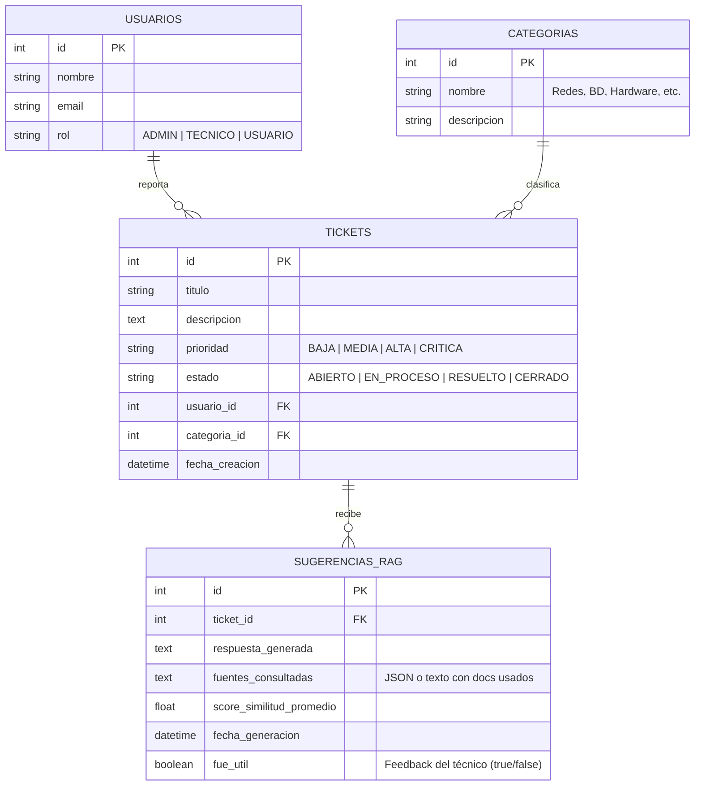

# Guía de Proyecto & Ejercicio Práctico: Implementación de RAG para un Sistema de Tickets (Helpdesk de TI)

> **Perfil del Desarrollador:** Estudiante de Ingeniería en Sistemas / Desarrollador Junior que busca aprender Inteligencia Artificial aplicada.  
> **Enfoque del Documento:** Arquitectura, toma de decisiones técnicas, componentes necesarios y criterios de implementación práctica (tanto para proyecto independiente como para integración en un sistema de tickets existente).  
> **Costo:** 100% Gratuito (Herramientas Open Source y Tiers Gratuitos sin tarjeta de crédito).

---

## 1. Introducción y Objetivos de Aprendizaje

### 1.1 ¿Qué es RAG desde la perspectiva de la Ingeniería de Software?
**RAG (Retrieval-Augmented Generation)** es un patrón de arquitectura de software que resuelve las dos limitaciones principales de los Modelos de Lenguaje (LLMs):
1. **Falta de conocimiento privado:** El modelo no conoce los datos internos de tu empresa o aplicación (manuales técnicos, políticas internas, tickets previos).
2. **Alucinaciones:** Cuando el modelo no sabe algo, inventa respuestas que suenan convincentes pero son incorrectas.

En lugar de reentrenar o ajustar (*fine-tuning*) un modelo (lo cual es costoso y complejo), RAG funciona como un examen a libro abierto:
* **Retrieval (Recuperación):** Ante la consulta del usuario, buscamos en una base de datos vectorial los fragmentos de documentos más relevantes.
* **Augmentation (Aumento):** Tomamos esos fragmentos y los inyectamos dentro del prompt que se le enviará al modelo.
* **Generation (Generación):** El LLM lee el contexto inyectado y redacta una respuesta fundamentada **únicamente** en dicha información.

```
[Usuario / Ticket] 
        │
        ▼
 1. Consulta ────► [Búsqueda Vectorial] ────► Obtiene fragmentos relevantes (Top-K)
                         │
                         ▼
 2. Inyección ───► [Prompt con Contexto]
                         │
                         ▼
 3. Inferencia ──► [LLM] ────► Respuesta con fuentes citadas
```

### 1.2 ¿Por qué una Base de Datos Relacional no es suficiente para esto?
En una base de datos relacional (como PostgreSQL o MySQL), las búsquedas se basan en coincidencias exactas o patrones (`LIKE '%error de red%'`, Full-Text Search con `tsvector`). Sin embargo:
* Si un usuario escribe *"No puedo acceder al servidor corporativo desde mi casa"*, una búsqueda tradicional buscará esas palabras clave.
* Un manual técnico titulado *"Configuración y solución de problemas de VPN GlobalProtect"* no contiene las palabras exactas, pero **significa lo mismo conceptualmente**.
* Las **Bases de Datos Vectoriales** calculan la cercanía matemática por **significado semántico** mediante vectores numéricos (*embeddings*), encontrando el documento correcto aunque se usen sinónimos o frases distintas.

---

## 2. El Desafío de Negocio: "DevDesk Copilot"

### 2.1 El Problema
Tu empresa ficticia (o tu sistema existente) cuenta con una plataforma de soporte técnico donde los empleados abren tickets diarios con incidencias como:
* Caídas de VPN.
* Bloqueo de credenciales de Active Directory.
* Errores de conexión a bases de datos (`Connection pool exhausted`, `SSL handshake failed`).
* Problemas con impresoras de red y certificados SSL.

El equipo de soporte pasa el 60% de su tiempo respondiendo lo mismo que ya está documentado en wikis internas y manuales técnicos en formato Markdown y PDF.

### 2.2 La Solución a Construir
Implementar un **módulo RAG** que:
1. Permita indexar los manuales técnicos internos de TI.
2. Ante un ticket nuevo o abierto, analice el título y la descripción del problema.
3. Encuentre automáticamente los procedimientos exactos en la base de conocimiento.
4. Genere un borrador de solución sugerida para el técnico de soporte, indicando exactamente qué archivo y sección se usó de referencia.

---

## 3. Modelo de Datos y Entidades

Para entender cómo se integra el RAG con una aplicación real, debemos separar dos mundos: **el mundo relacional (la app de tickets)** y **el mundo vectorial (la base de conocimiento)**.

### 3.1 Modelo Relacional (Base de Datos Tradicional: SQLite / PostgreSQL)

Representa las tablas de tu aplicación de tickets. Si ya tienes una app hecha, puedes mapear estas entidades a las tuyas:



#### Definición de Tablas (DDL de referencia en SQL):
```sql
CREATE TABLE usuarios (
    id INTEGER PRIMARY KEY AUTOINCREMENT,
    nombre VARCHAR(100) NOT NULL,
    email VARCHAR(100) UNIQUE NOT NULL,
    rol VARCHAR(20) DEFAULT 'USUARIO'
);

CREATE TABLE categorias (
    id INTEGER PRIMARY KEY AUTOINCREMENT,
    nombre VARCHAR(50) NOT NULL,
    descripcion TEXT
);

CREATE TABLE tickets (
    id INTEGER PRIMARY KEY AUTOINCREMENT,
    titulo VARCHAR(150) NOT NULL,
    descripcion TEXT NOT NULL,
    prioridad VARCHAR(20) DEFAULT 'MEDIA',
    estado VARCHAR(20) DEFAULT 'ABIERTO',
    usuario_id INTEGER REFERENCES usuarios(id),
    categoria_id INTEGER REFERENCES categorias(id),
    fecha_creacion DATETIME DEFAULT CURRENT_TIMESTAMP
);

CREATE TABLE sugerencias_rag (
    id INTEGER PRIMARY KEY AUTOINCREMENT,
    ticket_id INTEGER REFERENCES tickets(id) ON DELETE CASCADE,
    respuesta_generada TEXT NOT NULL,
    fuentes_consultadas TEXT NOT NULL, -- Ej: '["manual_vpn.md (Sección 2)", "politicas_red.md"]'
    score_similitud_promedio REAL,
    fecha_generacion DATETIME DEFAULT CURRENT_TIMESTAMP,
    fue_util BOOLEAN DEFAULT NULL
);
```

---

### 3.2 Modelo Vectorial (Colección en Base de Datos Vectorial: ChromaDB)

Una base de datos vectorial no guarda filas con columnas fijas tradicionales. Guarda **vectores numéricos** asociados a **documentos de texto** y un diccionario de **metadatos**:

| Campo en Colección Vectorial | Tipo | Descripción | Ejemplo |
| :--- | :--- | :--- | :--- |
| `id` | `string` | Identificador único del fragmento (*chunk*). | `"doc_vpn_chunk_003"` |
| `embedding` | `list[float]` | Vector numérico generado por el modelo de embeddings. | `[0.0234, -0.1582, 0.8912, ...]` (dimensión 384 o 768) |
| `document` | `string` | El fragmento de texto original que se indexó. | `"Para reiniciar el servicio de VPN en Windows, ejecute en PowerShell: Restart-Service -Name GlobalProtect..."` |
| `metadata` | `dict` | Diccionario clave-valor para filtrado y trazabilidad. | `{"archivo_origen": "manual_vpn.md", "categoria": "Redes", "chunk_index": 3}` |

---

### 3.3 Datos Fuente de la Base de Conocimiento (Archivos de Ejemplo)
Crea una carpeta llamada `docs_conocimiento/` en tu proyecto con archivos Markdown reales para alimentar el sistema. Por ejemplo:

1. `manual_vpn_remoto.md`: Pasos para solucionar error 502, error de certificados y reseteo de adaptador TAP/TUN.
2. `politicas_credenciales_ad.md`: Política de contraseñas, desbloqueo de cuentas en Active Directory y caducidad de tokens.
3. `errores_frecuentes_bd.md`: Qué hacer ante errores de `Connection refused (Port 5432)`, saturación de pool de conexiones y configuración de SSL.

---

## 4. Arquitectura de la Solución

El sistema se divide en dos tuberías (*pipelines*) independientes:

```
========================================================================================
1. PIPELINE DE INGESTIÓN (Se corre cuando hay manuales nuevos o actualizados)
========================================================================================
[Archivos .md / .txt] 
       │
       ▼
 [Extractor de Texto]
       │
       ▼
 [Estrategia de Chunking] ──► Divide documentos en bloques de ~400-500 caracteres
       │                       con solapamiento (overlap) de ~50 caracteres
       ▼
 [Modelo de Embeddings] ────► Convierte cada bloque en un vector (lista de floats)
       │
       ▼
 [Vector Store (ChromaDB)] ──► Guarda: {id, vector, texto_bloque, metadatos}


========================================================================================
2. PIPELINE DE INFERENCIA RAG (Se corre cuando llega un ticket)
========================================================================================
[Ticket Nuevo: Título + Descripción]
       │
       ▼
 [Modelo de Embeddings] ────► Convierte el texto del ticket en un vector de consulta
       │
       ▼
 [Vector Store (ChromaDB)] ──► Búsqueda por similitud del Coseno (Top-3 bloques)
       │
       ▼
 [Ensamblador de Prompt] ───► Inyecta: Contexto recuperado + Instrucción del Sistema + Ticket
       │
       ▼
 [LLM (Gemini / Groq)] ─────► Genera diagnóstico técnico con citas explícitas
       │
       ▼
 [Guardado Relacional] ─────► Inserta registro en la tabla `sugerencias_rag`
```

---

## 5. Stack Tecnológico Sugerido (100% Gratuito)

No necesitas contratar servidores de pago ni registrar tarjetas de crédito. Utilizaremos las siguientes herramientas:

| Componente | Tecnología | Justificación y Ventajas |
| :--- | :--- | :--- |
| **Lenguaje Backend** | **Python 3.10+** | El estándar de facto en Inteligencia Artificial y manipulación de datos. |
| **Framework Web** | **FastAPI** | Rápido, tipado estricto con Pydantic, genera documentación Swagger interactiva automáticamente en `/docs`. |
| **Base de Datos Relacional** | **SQLite** (o PostgreSQL existente) | Viene integrado en Python sin instalar nada. Si ya tienes PostgreSQL o MySQL en tu app de tickets, úsalos con SQLAlchemy. |
| **Base de Datos Vectorial** | **ChromaDB** | Biblioteca de Python gratuita y open-source. Funciona en memoria o persistida en una carpeta local de tu disco sin levantar servidores Docker complejos. |
| **Modelo de Embeddings** | **HuggingFace (`all-MiniLM-L6-v2`)** | Modelo open-source pequeño (~80MB), corre localmente en tu CPU en milisegundos y **no consume tokens ni APIs**. |
| **LLM (Generador)** | **Google Gemini API** (Tier Gratis) o **Groq Cloud API** | Ambos ofrecen niveles gratuitos muy generosos (Gemini 1.5/2.0 Flash o Groq con Llama 3 8B), ideales para desarrollo. |
| **Frontend** | **HTML5 + Vanilla JS** o **Streamlit** | Si integras a tu app actual, un modal/panel en Vanilla JS. Si es proyecto aparte, Streamlit o un HTML moderno con Fetch API. |

---

## 6. Ruta de Implementación Guiada (Cómo Pensarlo y Construirlo)

### Fase 1: Entorno y Dependencias

Crea un entorno virtual de Python y tu archivo `requirements.txt`:

```bash
# Crear entorno virtual
python -m venv venv

# Activar en Windows PowerShell:
.\venv\Scripts\Activate.ps1

# Activar en Linux/Mac:
source venv/bin/activate
```

Dependencias recomendadas en `requirements.txt`:
```text
fastapi>=0.110.0
uvicorn>=0.28.0
chromadb>=0.4.24
sentence-transformers>=2.5.1
google-genai>=0.1.1       # O alternativa: groq>=0.4.0
pydantic>=2.6.0
python-dotenv>=1.0.1
sqlite3                   # Ya incluido en estándar de Python
```

---

### Fase 2: Pipeline de Ingestión de Conocimiento

#### A. El Concepto de *Chunking* (Fragmentación)
Un LLM no puede recibir un PDF de 200 páginas completo para cada pregunta (sería lento y costoso). Debes dividir los textos en fragmentos (*chunks*).
* **Tamaño del Chunk (`chunk_size`):** ~400 a 600 caracteres (suficiente para contener una instrucción o solución coherente).
* **Solapamiento (`chunk_overlap`):** ~50 a 100 caracteres. Permite que las frases que quedan cortadas en el borde de un bloque conserven su significado con el bloque siguiente.

#### B. Generación de Embeddings
Un embedding es una función matemática que toma texto y retorna una lista de números en un espacio vectorial multidimensional:
$$\text{Texto} \xrightarrow{\text{Modelo de Embeddings}} [x_1, x_2, \dots, x_{384}]$$
Textos con significado similar tendrán vectores con un ángulo muy pequeño entre sí (medido mediante **Similitud del Coseno**).

#### C. Código Conceptual para Ingestión (`ingest.py`):
```python
# Lógica estructural para que el estudiante comprenda el flujo de indexación
import os
import chromadb
from sentence_transformers import SentenceTransformer

# 1. Inicializar cliente de ChromaDB persistente en disco
chroma_client = chromadb.PersistentClient(path="./chroma_db")
collection = chroma_client.get_or_create_collection(name="manuales_ti")

# 2. Cargar modelo de embeddings local (corre en CPU gratis)
embedding_model = SentenceTransformer("all-MiniLM-L6-v2")

def dividir_en_chunks(texto: str, tamano: int = 500, solapamiento: int = 50) -> list[str]:
    chunks = []
    inicio = 0
    while inicio < len(texto):
        fin = inicio + tamano
        chunks.append(texto[inicio:fin])
        inicio += tamano - solapamiento
    return chunks

def indexar_carpeta_documentos(directorio: str):
    for archivo in os.listdir(directorio):
        if archivo.endswith(".md") or archivo.endswith(".txt"):
            ruta = os.path.join(directorio, archivo)
            with open(ruta, "r", encoding="utf-8") as f:
                contenido = f.read()

            chunks = dividir_en_chunks(contenido)
            for idx, chunk in enumerate(chunks):
                # Generar embedding del fragmento
                vector = embedding_model.encode(chunk).tolist()
                
                # Guardar en la base de datos vectorial con metadatos
                collection.add(
                    ids=[f"{archivo}_chunk_{idx}"],
                    embeddings=[vector],
                    documents=[chunk],
                    metadatas=[{"fuente": archivo, "chunk_index": idx}]
                )
    print("Ingestión completada exitosamente.")
```

---

### Fase 3: Pipeline de Recuperación e Inferencia RAG

Esta es la lógica nuclear donde ocurre la "magia" del RAG.

#### A. Búsqueda por Similitud
Cuando llega la descripción de un ticket:
1. Conviertes el texto del ticket en un vector con el **mismo modelo de embeddings**.
2. Le pides a ChromaDB los $K$ fragmentos más cercanos (usualmente $K = 2$ o $3$).

#### B. Construcción del Prompt Aumentado
Debes diseñar una plantilla de prompt que instruya al LLM con tres reglas de oro:
1. Actuar como especialista de soporte de TI.
2. Usar **únicamente** la información provista en el bloque `CONTEXTO`.
3. Si el contexto no contiene la solución, responder explícitamente: *"No se encontró información en los manuales internos para resolver este problema."* (evita alucinaciones).
4. Indicar el nombre del manual o fuente utilizada.

#### C. Estructura del Prompt:
```text
Eres un asistente técnico de soporte de TI de nivel 2.
Tu trabajo es formular una recomendación clara para resolver el ticket del usuario,
basándote EXCLUSIVAMENTE en el siguiente contexto extraído de nuestros manuales oficiales.

---
CONTEXTO DE MANUALES INTERNOS:
{contexto_recuperado}
---

TICKET A RESOLVER:
- Título: {titulo_ticket}
- Descripción: {descripcion_ticket}

INSTRUCCIONES:
1. Proporciona los pasos ordenados para que el técnico resuelva la incidencia.
2. Cita expresamente el nombre del documento fuente usado.
3. Si la información no es suficiente en el contexto provisto, indícalo con total transparencia.
```

---

### Fase 4: Exposición mediante API REST con FastAPI

El backend de tu aplicación debe exponer endpoints claros para que cualquier interfaz (o tu app de tickets existente) pueda consumir el RAG.

#### Endpoints recomendados a construir en `main.py`:

| Método | Ruta | Parámetros / Body | Descripción |
| :--- | :--- | :--- | :--- |
| `POST` | `/api/conocimiento/ingestar` | Ninguno o archivo | Dispara la reindexación de los documentos de la carpeta. |
| `GET` | `/api/tickets` | Query params (`estado`) | Lista los tickets existentes desde la BD relacional. |
| `POST` | `/api/tickets` | `{titulo, descripcion, usuario_id, categoria_id}` | Crea un ticket nuevo en la BD relacional. |
| `POST` | `/api/tickets/{ticket_id}/sugerir-solucion` | Path: `ticket_id` | **Endpoint Estrella:** Lee el ticket de la BD relacional, ejecuta el RAG, guarda la sugerencia en `sugerencias_rag` y retorna la respuesta generada con sus fuentes. |
| `POST` | `/api/sugerencias/{id}/feedback` | `{fue_util: boolean}` | Registra si la sugerencia del RAG ayudó al técnico (vital para auditoría). |

#### Esqueleto Conceptual del Endpoint RAG:
```python
from fastapi import FastAPI, HTTPException
from pydantic import BaseModel

app = FastAPI(title="DevDesk RAG Copilot API")

@app.post("/api/tickets/{ticket_id}/sugerir-solucion")
def sugerir_solucion(ticket_id: int):
    # 1. Obtener el ticket de la base de datos relacional
    ticket = db_obtener_ticket_por_id(ticket_id)
    if not ticket:
        raise HTTPException(status_code=404, detail="Ticket no encontrado")

    # 2. Vectorizar la consulta (título + descripción)
    texto_consulta = f"{ticket['titulo']} {ticket['descripcion']}"
    vector_consulta = embedding_model.encode(texto_consulta).tolist()

    # 3. Recuperar los 2 fragmentos más relevantes de ChromaDB
    resultados = collection.query(
        query_embeddings=[vector_consulta],
        n_results=2
    )

    documentos = resultados["documents"][0]
    metadatos = resultados["metadatas"][0]
    
    contexto_unido = "\n\n".join(documentos)
    fuentes = list(set([m["fuente"] for m in metadatos]))

    # 4. Enviar a LLM (Google Gemini o Groq) con el prompt estructurado
    respuesta_ia = llamar_llm_con_contexto(
        titulo=ticket["titulo"], 
        descripcion=ticket["descripcion"], 
        contexto=contexto_unido
    )

    # 5. Persistir en la tabla relacional sugerencias_rag
    sugerencia_id = db_guardar_sugerencia(
        ticket_id=ticket_id, 
        respuesta=respuesta_ia, 
        fuentes=str(fuentes)
    )

    return {
        "sugerencia_id": sugerencia_id,
        "ticket_id": ticket_id,
        "solucion_propuesta": respuesta_ia,
        "fuentes_consultadas": fuentes
    }
```

---

### Fase 5: Integración con Frontend

Si ya tienes un frontend para tu sistema de tickets, añade un componente sencillo:
1. En la vista de detalle del ticket (`/tickets/{id}`), añade un botón: **"⚡ Generar Diagnóstico con IA (RAG)"**.
2. Al hacer clic:
   * Muestra un indicador de carga (*spinner*).
   * Realiza una petición `POST` al endpoint `/api/tickets/{id}/sugerir-solucion`.
   * Muestra un panel lateral o tarjeta destacada con:
     * El texto de la solución paso a paso.
     * Insignias (*badges*) con los manuales consultados (ej. `[manual_vpn.md]`).
     * Dos botones de feedback: `👍 Útil` o `👎 No resolvió el problema`.

---

## 7. Entregables y Criterios de Éxito

Para validar que el estudiante ha comprendido los conceptos y que la solución de ingeniería es exitosa, se deben cumplir los siguientes entregables y pruebas de aceptación:

### 7.1 Lista de Entregables
1. **Repositorio de Código:**
   * Código fuente en Python con la arquitectura modular (`main.py`, `rag_service.py`, `database.py`, `config.py`).
   * Archivo `requirements.txt` limpio con las versiones especificadas.
   * Archivo `.env.example` donde se especifique la clave del LLM (`GEMINI_API_KEY` o `GROQ_API_KEY`).
2. **Carpeta de Conocimiento Inicial (`docs/`):**
   * Al menos 3 documentos en formato Markdown con procedimientos técnicos reales (VPN, Base de Datos, Cuentas de Correo).
3. **Base de Datos Configurada:**
   * Script de creación de tablas o migración para SQLite/PostgreSQL con las 4 tablas principales (`usuarios`, `categorias`, `tickets`, `sugerencias_rag`).
4. **Carpeta Persistente del Vector Store:**
   * Directorio `chroma_db/` generado tras ejecutar el proceso de ingestión.

---

### 7.2 Pruebas de Aceptación (Casos de Prueba que deben pasar)

| Caso de Prueba | Entrada / Acción | Resultado Esperado | ¿Por qué es crítico? |
| :--- | :--- | :--- | :--- |
| **CP-01: Ingestión Correcta** | Ejecutar script de ingestión con 3 documentos `.md`. | La colección de ChromaDB almacena los chunks y metadatos sin errores. El conteo de documentos en ChromaDB es $> 0$. | Demuestra que el estudiante domina el ciclo de lectura, chunking y almacenamiento vectorial. |
| **CP-02: Búsqueda Semántica (Retrieval Puro)** | Consulta de prueba: *"No me conecta el internet de la empresa desde el hotel"*. | ChromaDB retorna fragmentos de `manual_vpn_remoto.md`, aunque la palabra "hotel" o "internet" no aparezcan textualmente en el manual. | Comprueba que el estudiante comprende la similitud semántica frente a un `LIKE` de SQL. |
| **CP-03: Generación con Contexto y Citas** | Ticket: *"Error al conectar a PostgreSQL: pool exhausted"*. | El endpoint devuelve una respuesta con comandos técnicos específicos extraídos de `errores_frecuentes_bd.md` y lista ese archivo en `fuentes_consultadas`. | Valida la integración de RAG extremo a extremo. |
| **CP-04: Control de Alucinaciones (Fallback)** | Ticket: *"¿Cómo solicito vacaciones para la próxima semana?"* (Tema no documentado en los manuales de TI). | El sistema responde explícitamente indicando que no dispone de información en los manuales para ese tema, **sin inventar procedimientos**. | Demuestra que el prompt fue diseñado con guardrails de ingeniería y no como un chatbot descontrolado. |
| **CP-05: Persistencia Relacional** | Generar una solución para el ticket #1. | Se inserta una fila en la tabla `sugerencias_rag` asociada mediante clave foránea al `ticket_id = 1`. | Demuestra que el RAG no es un script suelto, sino que se integra con el ciclo de vida de la aplicación. |

---

## 8. Resumen de Comandos Rápidos para el Estudiante

```bash
# 1. Instalar dependencias
pip install -r requirements.txt

# 2. Ejecutar la ingestión de manuales
python ingest.py

# 3. Iniciar el servidor API de FastAPI
uvicorn main:app --reload --port 8000

# 4. Probar los endpoints en Swagger UI
# Abrir en el navegador: http://localhost:8000/docs
```
